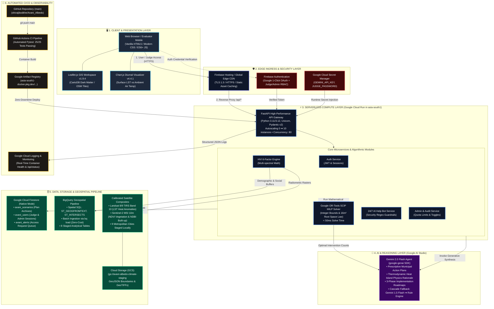

# 🏛️ Avani Albedo — Official GCP Architecture Diagramming Flow Guide

> **Target Tool:** [draw.io (diagrams.net)](https://app.diagrams.net/)  
> **Destination in Submission:** Slide 8 of `AI Builder Cup.pptx` & Architecture Documentation  
> **Theme:** Enterprise Google Cloud Platform Architecture (100% Code-Verified)  

This guide provides the complete, component-by-component blueprint to build a professional, publication-grade architecture diagram in **draw.io** for the **Google Cloud AI Builder Cup 2026**.

---

## ⚡ 1-Click Draw.io Import Options

You can build this in **draw.io** using either:
1. **Option 1 (Instant):** Open draw.io $\rightarrow$ **Arrange** $\rightarrow$ **Insert** $\rightarrow$ **Advanced** $\rightarrow$ **Mermaid**, and paste the diagram below.
2. **Option 2 (Manual Shapes):** Use the official Google Cloud shape library in draw.io (**More Shapes** $\rightarrow$ Check **Google Cloud Platform**) and follow the Component Inventory and Connection Matrix in Sections 2 and 3.

---

## 📊 1. Master System Architecture Flow (Mermaid Diagram)



---

## 📋 2. Draw.io Component Inventory & Icon Guide

When drawing the shapes in draw.io, search for these exact shape names in the **GCP Icons** shape library:

| Layer / Box | Component Name in Diagram | Recommended Draw.io Icon / Shape | Color Palette | Key Details to Include in Label |
| :--- | :--- | :--- | :--- | :--- |
| **Client** | Evaluator Browser / UI | `User` / `Laptop` / `Globe` | Slate Dark `#1E293B` | `Vanilla JS, HTML5, Leaflet.js, Chart.js` |
| **Ingress** | Firebase Hosting CDN | `Firebase Hosting` | Amber `#F59E0B` | `Global Edge CDN • TLS 1.3 • SSL Termination` |
| **Identity** | Firebase Authentication | `Firebase Authentication` / `Identity Platform` | Amber `#D97706` | `Google 1-Click OAuth • Judge Bypass • RBAC` |
| **Secrets** | Google Cloud Secret Manager | `Secret Manager` | Red `#DC2626` | `GEMINI_API_KEY, JUDGE_PASSWORD injected at runtime` |
| **Compute** | Google Cloud Run | `Cloud Run` | Blue `#2563EB` | `FastAPI (Python 3.12) • 0➔10 Autoscaling • asia-south1` |
| **Optimizer** | Google OR-Tools SCIP | `Cloud Endpoints` / `Optimization Box` | Indigo `#4F46E5` | `SCIP Mixed-Integer Linear Programming • <50ms solve` |
| **AI / Agent** | Gemini 2.0 Flash | `Gemini` / `Vertex AI` / `AI Studio` | Purple `#9333EA` | `google-genai SDK • Persona Plans • Thermodynamic Rationale` |
| **Database** | Google Cloud Firestore | `Cloud Firestore` | Green `#059669` | `Native Mode • avani_scenarios, avani_users, avani_alerts` |
| **Analytics** | BigQuery Geospatial | `BigQuery` | Sky Blue `#0284C7` | `Spatial SQL (ST_GEOGFROMTEXT) • Offline Staging Pipeline` |
| **Satellite** | Landsat 8/9 & Sentinel-2 | `Satellite` / `Earth Engine` | Orange `#EA580C` | `TIRS Band 10 LST & MSI 10m NDVI/NDBI (9 Cities)` |
| **Storage** | Google Cloud Storage | `Cloud Storage (GCS)` | Cyan `#0891B2` | `gs://avani-albedo-climate-staging • GeoTIFFs` |
| **CI/CD** | GitHub Actions & Artifact Registry | `Artifact Registry` / `Cloud Build` | Gray `#475569` | `Automated Pytest (25/25 Passing) • Continuous Deploy` |

---

## 🔄 3. Numbered Data Flow & Interaction Sequence

Use numbered circle callouts `(1)` through `(8)` on your connection arrows in draw.io:

```
[Evaluator] ──(1) HTTPS──► [Firebase Hosting CDN] ──(2) Reverse Proxy──► [Cloud Run: FastAPI]
                                                                                │
          ┌─────────────────────────────────────────────────────────────────────┼──────────────────────────────────┐
          ▼ (3) Auth Check                                                      ▼ (4) Data Lookup                  ▼ (5) Math Optimization
  [Firebase Auth]                                                        [Calibrated Satellites]            [Google OR-Tools SCIP]
          │ (JWT Verified)                                                      │ (LST, NDVI, NDBI)                │ (<50ms Solve)
          ▼                                                                     ▼                                  ▼
  [Cloud Run Service] ◄─────────────────────────────────────────────────────────┴──────────────────────────────────┘
          │
          ├──────────────(6) Synthesize Plan & Roadmaps──────────────► [Gemini 2.0 Flash (Google AI)]
          │                                                                     │ (Thermodynamic Rationale)
          │◄────────────────────────────────────────────────────────────────────┘
          │
          ├──────────────(7) Persist Scenarios & Audits──────────────► [Cloud Firestore Native Mode]
          │                                                               (`avani_scenarios` collection)
          │
          └──────────────(8) Render Real-Time Action Plan────────────► [Leaflet GIS & Diurnal Timeline]
```

### Detailed Sequence Descriptions:
1. **(1) Ingress:** The Evaluator or Municipal Commissioner accesses `https://avani-albedo-hbxrfbol2a-el.a.run.app` via TLS 1.3 encrypted HTTPS.
2. **(2) Reverse Proxy:** Firebase Hosting routes API traffic to containerized **Google Cloud Run** in `asia-south1`.
3. **(3) Identity & Secrets:** The request is authenticated via **Firebase Auth** / JWT; secrets (`GEMINI_API_KEY`) are resolved from **Google Secret Manager**.
4. **(4) Telemetry Retrieval:** The engine queries calibrated satellite composites for the selected ward (LST thermal anomalies, NDVI, and NDBI).
5. **(5) Prescriptive Optimization:** In `<35ms`, **Google OR-Tools** solves the Mixed-Integer Linear Program, calculating the exact integer counts of Trees, Cool Roofs, Shade Canopies, and Hydration Kiosks under municipal budget limits and the strict 16 m² root space carrying capacity bound.
6. **(6) Gemini 2.0 Flash Synthesis:** The numerical allocation is passed to **Gemini 2.0 Flash** via the `google-genai` SDK to author an executive brief, thermodynamic physics explanation, and 3-phase implementation roadmap.
7. **(7) Persistence:** The generated scenario, audit trail, and spatial coordinates are committed to **Google Cloud Firestore Native Mode** in the `avani_scenarios` collection.
8. **(8) Presentation:** The complete responsive action plan, Pareto charts, and geospatial markers are rendered dynamically in **Leaflet.js** and **Chart.js**.

---

## 🎨 4. Professional Visual Design Guidelines for Draw.io

To match Google Cloud's official design aesthetics:

* **Canvas Setup:**
  * Page Size: **16:9 Widescreen** (1920 × 1080 px) or **A4 Landscape**.
  * Grid: Enabled (Grid Size: `10pt`).
  * Background: Sleek dark canvas `#0B0F19` or clean white `#FFFFFF`.
* **Container Groupings (Swimlanes):**
  * Use rounded rectangle containers with `15% opacity fill` and `1.5pt dashed or solid borders` to clearly separate the 6 architectural tiers.
* **Connection Line Styles:**
  * Line Style: **Orthogonal** (rounded corners, radius `5`).
  * Flow arrows: Width `2pt`, color `#60A5FA` (Blue) or `#34D399` (Green).
  * Data flows: Solid arrows.
  * Security & telemetry flows: Dashed arrows.
* **Typography:**
  * Headers: **Google Sans** or **Inter** Bold (14pt to 16pt).
  * Component Labels: **Inter** Semi-Bold (11pt to 12pt).
  * Metadata & Specs: **JetBrains Mono** or **Roboto Mono** Regular (9pt to 10pt).

---

## 📦 5. Exporting for the Pitch Deck & Submission

1. In draw.io, select **File** $\rightarrow$ **Export as** $\rightarrow$ **PNG**.
2. **Settings:**
   * Zoom: **200%** or **300%** (for ultra-crisp Retina / 4K display in PowerPoint).
   * Transparent Background: Checked (or dark background matching your slide theme).
3. Insert directly into **Slide 8** of your `AI Builder Cup.pptx` pitch deck!
