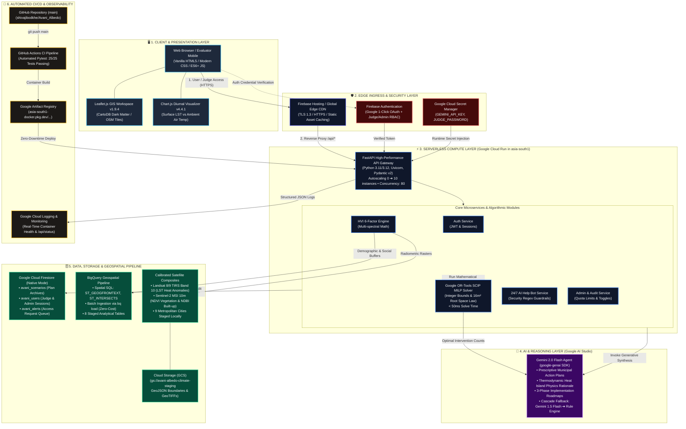

# 🏛️ Avani Albedo — Official GCP Architecture Diagramming Flow Guide

> **Target Tool:** [draw.io (diagrams.net)](https://app.diagrams.net/)  
> **Destination in Submission:** Slide 8 of `AI Builder Cup.pptx` & Architecture Documentation  
> **Theme:** Enterprise Google Cloud Platform Architecture (100% Code-Verified)  

This guide provides the complete, component-by-component blueprint to build a professional, publication-grade architecture diagram in **draw.io** for the **Google Cloud AI Builder Cup 2026**.

---

## ⚡ 1-Click Draw.io Import Options

You can build this in **draw.io** using either:
1. **Option 1 (Instant):** Open draw.io $\rightarrow$ **Arrange** $\rightarrow$ **Insert** $\rightarrow$ **Advanced** $\rightarrow$ **Mermaid**, and paste the diagram below.
2. **Option 2 (Manual Shapes):** Use the official Google Cloud shape library in draw.io (**More Shapes** $\rightarrow$ Check **Google Cloud Platform**) and follow the Component Inventory and Connection Matrix in Sections 2 and 3.

---

## 📊 1. Master System Architecture Flow (Mermaid Diagram)



---

## 📋 2. Exact Icon Mapping from your draw.io GCP Panel

In your draw.io search panel for `gcp` (shown in your screenshot), pick these exact icons:

| Component in Avani Albedo | Exact Icon to Drag from Your Screenshot Panel | Icon Position in your draw.io Panel | Label to Write Below Icon |
| :--- | :--- | :--- | :--- |
| **Serverless Compute** | **`Cloud Run`** | Row 6, Column 2 *(Multi-colored double chevron)* | **Google Cloud Run**<br>`FastAPI • 0➔10 Auto-Scaling • asia-south1` |
| **Generative AI Agent** | **`Vertex AI`** or **`AI Applications & Agents`** | Row 8, Column 5 *(Colored vertical bars)* or Row 1, Col 1 | **Gemini 2.0 Flash (Google AI)**<br>`Prescriptive Roadmaps & Thermodynamic Physics` |
| **Geospatial Analytics** | **`BigQuery`** | Row 6, Column 1 *(Magnifying glass on bar charts)* | **BigQuery Geospatial Pipeline**<br>`Spatial SQL: ST_GEOGFROMTEXT, ST_INTERSECTS` |
| **Object / Raster Storage** | **`Cloud Storage`** | Row 6, Column 5 *(Blue & orange bucket drawer)* | **Google Cloud Storage (GCS)**<br>`gs://avani-albedo-climate-staging • GeoTIFFs` |
| **NoSQL Database** | **`Databases`** (or search `Firestore`) | Row 2, Column 3 *(Three-layer blue cylinder)* | **Cloud Firestore (Native Mode)**<br>`avani_scenarios, avani_users, avani_alerts` |
| **Satellite GIS & Maps** | **`Maps & Geospatial`** | Row 3, Column 4 *(Blue location pin on globe)* | **Leaflet.js GIS & Satellites**<br>`Landsat 8/9 TIRS LST & Sentinel-2 MSI NDVI` |
| **Security & Secrets** | **`Security & Identity`** | Row 4, Column 2 *(Blue shield with person)* | **Firebase Auth & Secret Manager**<br>`Google 1-Click OAuth • RBAC • Injected Secrets` |
| **Client Frontend** | **`Web and Mobile`** | Row 4, Column 5 *(Desktop and phone screens)* | **Evaluator Browser UI**<br>`Vanilla JS, HTML5, Chart.js Diurnal Curves` |
| **Optimization Solver** | **`Compute`** | Row 1, Column 5 *(Blue lightning bolt)* | **Google OR-Tools SCIP**<br>`Integer MILP Solver • 16 m² Root Space Bound` |
| **CI/CD Pipeline** | **`DevOps`** or **`Developer Tools`** | Row 2, Column 6 *(Infinity ribbon)* or Row 2, Col 5 | **CI/CD & Cloud Build**<br>`GitHub Actions • 25/25 Pytest Passing` |
| **Monitoring & Logs** | **`Observability`** | Row 3, Column 6 *(Blue square bar chart)* | **Cloud Logging & Probes**<br>`/api/status • Health & Audit Telemetry` |

---

### 🎨 How to Arrange These 11 Icons on Your Canvas:

1. **Top Row (Client & Ingress):**
   * Place **`Web and Mobile`** (Left) $\rightarrow$ Arrow $\rightarrow$ **`Security & Identity`** (Right).
2. **Center Core (Compute & Optimization):**
   * Place **`Cloud Run`** in a prominent central position.
   * Right next to it, place **`Compute`** (Google OR-Tools) with a two-way arrow.
3. **Right Flank (AI Reasoning):**
   * Place **`Vertex AI / AI Applications & Agents`** (Gemini 2.0 Flash) connected to **`Cloud Run`**.
4. **Bottom Row (Data & Storage Pipeline):**
   * Place **`Databases`** (Firestore) in the center-bottom connected to **`Cloud Run`**.
   * Place **`BigQuery`** and **`Cloud Storage`** to the bottom-left.
   * Place **`Maps & Geospatial`** (Satellite telemetry) connected into **`Cloud Run`**.
5. **Left or Top Edge (DevOps & Observability):**
   * Place **`DevOps`** pointing into **`Cloud Run`**.
   * Place **`Observability`** receiving logs from **`Cloud Run`**.

---

## 🔄 3. Numbered Data Flow & Interaction Sequence

Use numbered circle callouts `(1)` through `(8)` on your connection arrows in draw.io:

```
[Evaluator] ──(1) HTTPS──► [Firebase Hosting CDN] ──(2) Reverse Proxy──► [Cloud Run: FastAPI]
                                                                                │
          ┌─────────────────────────────────────────────────────────────────────┼──────────────────────────────────┐
          ▼ (3) Auth Check                                                      ▼ (4) Data Lookup                  ▼ (5) Math Optimization
  [Firebase Auth]                                                        [Calibrated Satellites]            [Google OR-Tools SCIP]
          │ (JWT Verified)                                                      │ (LST, NDVI, NDBI)                │ (<50ms Solve)
          ▼                                                                     ▼                                  ▼
  [Cloud Run Service] ◄─────────────────────────────────────────────────────────┴──────────────────────────────────┘
          │
          ├──────────────(6) Synthesize Plan & Roadmaps──────────────► [Gemini 2.0 Flash (Google AI)]
          │                                                                     │ (Thermodynamic Rationale)
          │◄────────────────────────────────────────────────────────────────────┘
          │
          ├──────────────(7) Persist Scenarios & Audits──────────────► [Cloud Firestore Native Mode]
          │                                                               (`avani_scenarios` collection)
          │
          └──────────────(8) Render Real-Time Action Plan────────────► [Leaflet GIS & Diurnal Timeline]
```

### Detailed Sequence Descriptions:
1. **(1) Ingress:** The Evaluator or Municipal Commissioner accesses `https://avani-albedo-hbxrfbol2a-el.a.run.app` via TLS 1.3 encrypted HTTPS.
2. **(2) Reverse Proxy:** Firebase Hosting routes API traffic to containerized **Google Cloud Run** in `asia-south1`.
3. **(3) Identity & Secrets:** The request is authenticated via **Firebase Auth** / JWT; secrets (`GEMINI_API_KEY`) are resolved from **Google Secret Manager**.
4. **(4) Telemetry Retrieval:** The engine queries calibrated satellite composites for the selected ward (LST thermal anomalies, NDVI, and NDBI).
5. **(5) Prescriptive Optimization:** In `<35ms`, **Google OR-Tools** solves the Mixed-Integer Linear Program, calculating the exact integer counts of Trees, Cool Roofs, Shade Canopies, and Hydration Kiosks under municipal budget limits and the strict 16 m² root space carrying capacity bound.
6. **(6) Gemini 2.0 Flash Synthesis:** The numerical allocation is passed to **Gemini 2.0 Flash** via the `google-genai` SDK to author an executive brief, thermodynamic physics explanation, and 3-phase implementation roadmap.
7. **(7) Persistence:** The generated scenario, audit trail, and spatial coordinates are committed to **Google Cloud Firestore Native Mode** in the `avani_scenarios` collection.
8. **(8) Presentation:** The complete responsive action plan, Pareto charts, and geospatial markers are rendered dynamically in **Leaflet.js** and **Chart.js**.

---

## 🎨 4. Professional Visual Design Guidelines for Draw.io

To match Google Cloud's official design aesthetics:

* **Canvas Setup:**
  * Page Size: **16:9 Widescreen** (1920 × 1080 px) or **A4 Landscape**.
  * Grid: Enabled (Grid Size: `10pt`).
  * Background: Sleek dark canvas `#0B0F19` or clean white `#FFFFFF`.
* **Container Groupings (Swimlanes):**
  * Use rounded rectangle containers with `15% opacity fill` and `1.5pt dashed or solid borders` to clearly separate the 6 architectural tiers.
* **Connection Line Styles:**
  * Line Style: **Orthogonal** (rounded corners, radius `5`).
  * Flow arrows: Width `2pt`, color `#60A5FA` (Blue) or `#34D399` (Green).
  * Data flows: Solid arrows.
  * Security & telemetry flows: Dashed arrows.
* **Typography:**
  * Headers: **Google Sans** or **Inter** Bold (14pt to 16pt).
  * Component Labels: **Inter** Semi-Bold (11pt to 12pt).
  * Metadata & Specs: **JetBrains Mono** or **Roboto Mono** Regular (9pt to 10pt).

---

## 📦 5. Exporting for the Pitch Deck & Submission

1. In draw.io, select **File** $\rightarrow$ **Export as** $\rightarrow$ **PNG**.
2. **Settings:**
   * Zoom: **200%** or **300%** (for ultra-crisp Retina / 4K display in PowerPoint).
   * Transparent Background: Checked (or dark background matching your slide theme).
3. Insert directly into **Slide 8** of your `AI Builder Cup.pptx` pitch deck!
